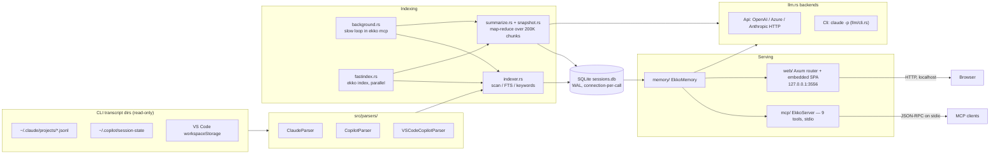
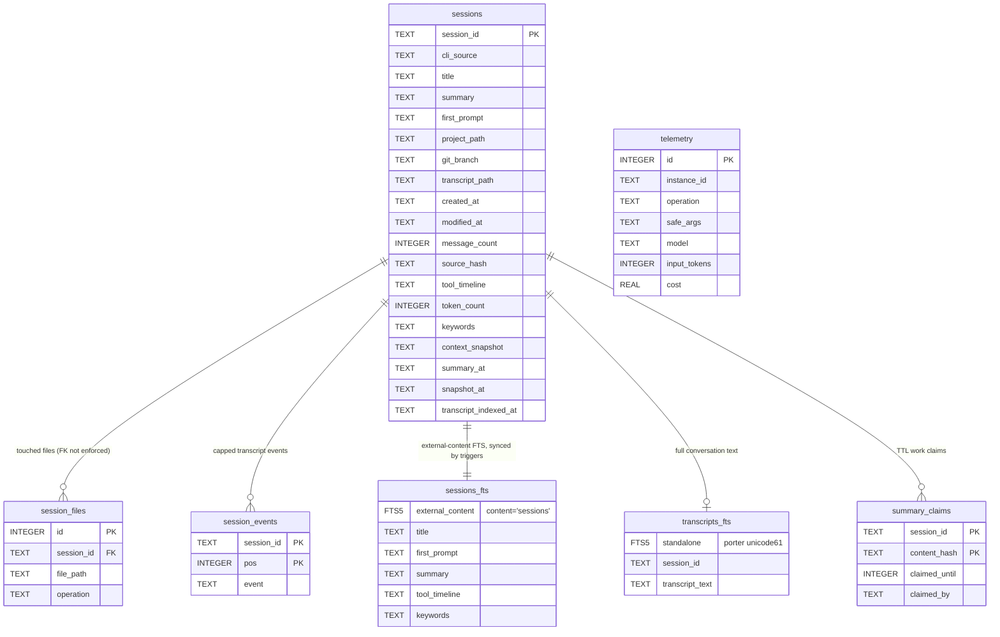
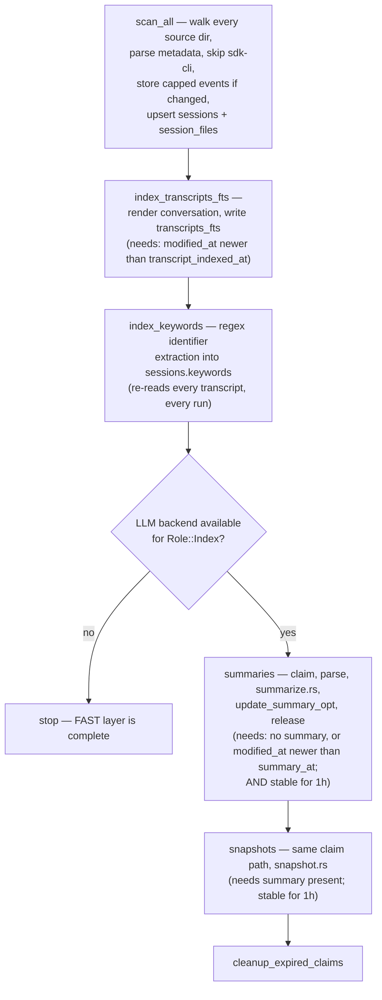
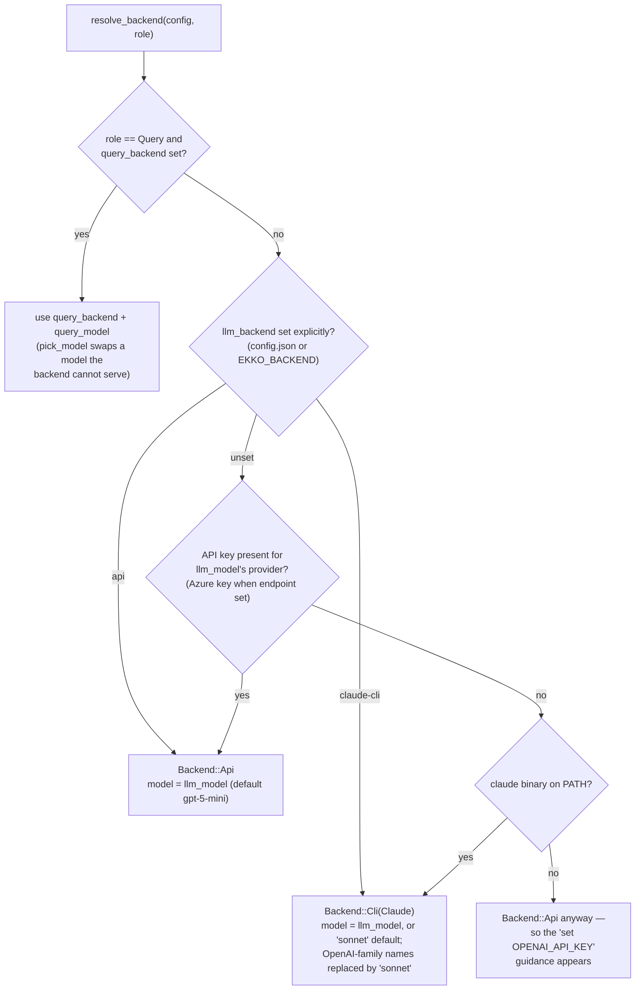
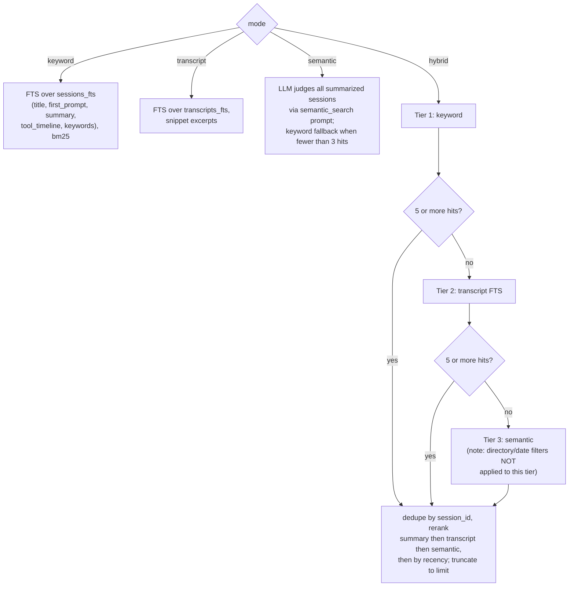
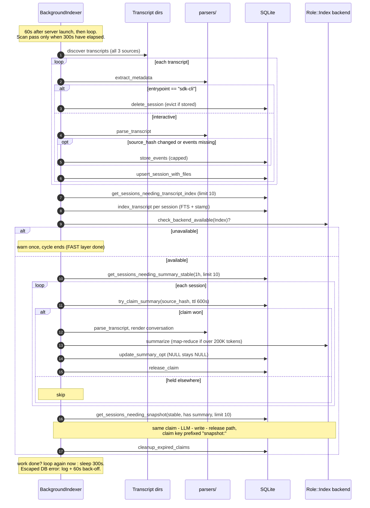
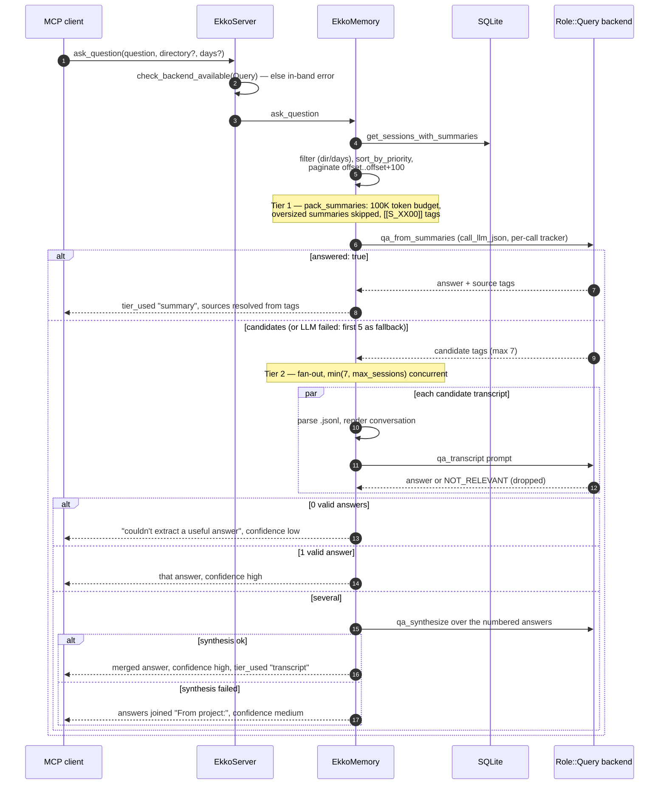
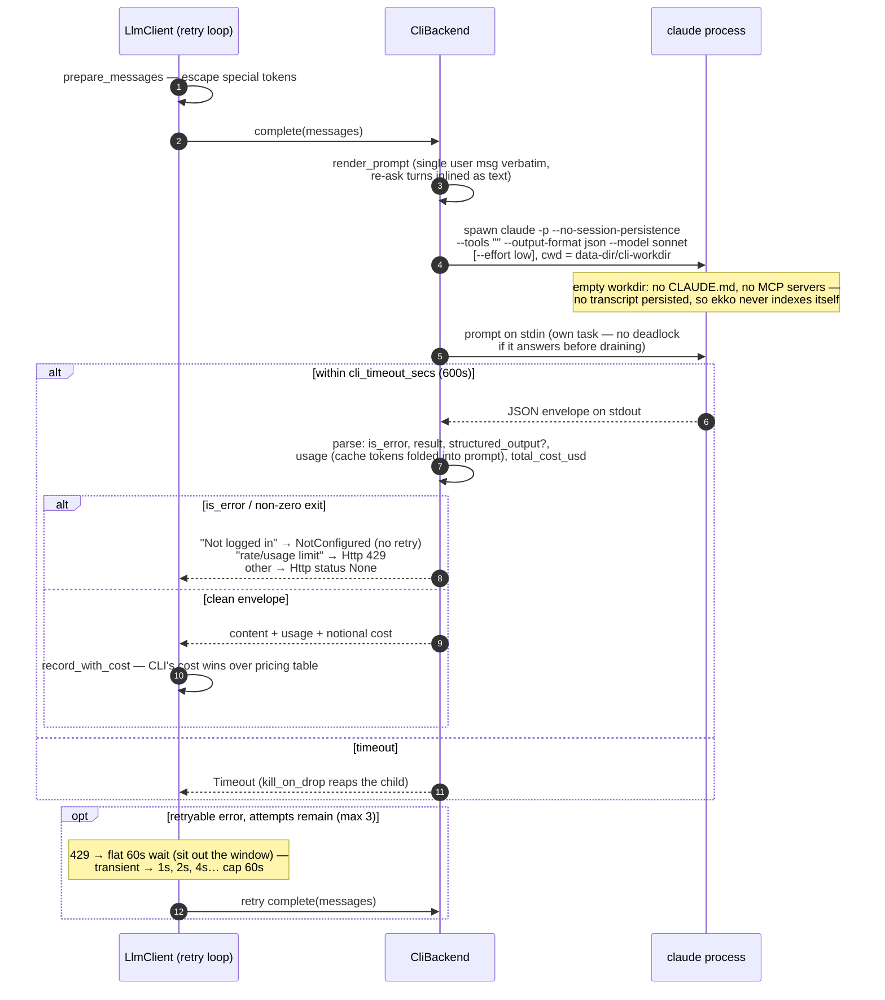
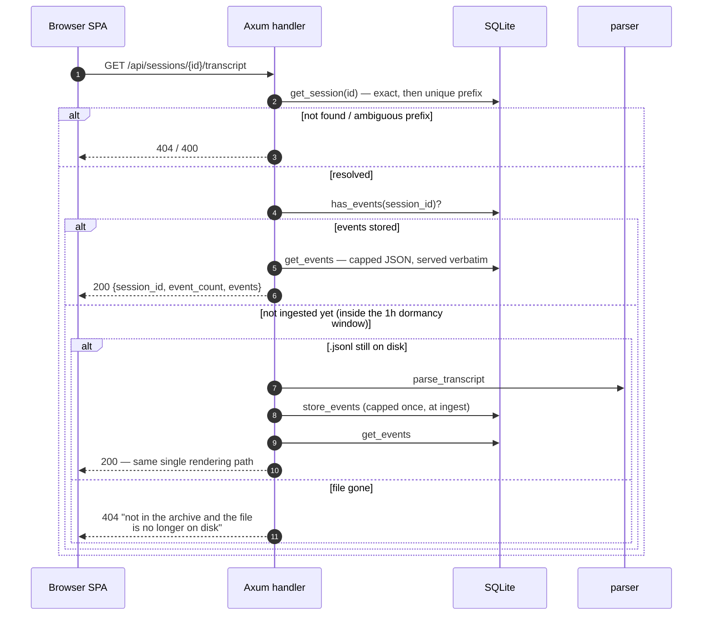

# ekko

Architecture reference — Rust MCP server that archives AI coding-assistant sessions. Verified against the code as of 2026-08-23, with the web co-hosting section updated 2026-11-23.

## 1. Overview

ekko reads the transcript directories that Claude Code (`~/.claude/projects`), GitHub Copilot CLI (`~/.copilot/session-state`) and VS Code Copilot (`workspaceStorage`) already write, indexes them into one SQLite file, and serves search / browse / Q&A over them. It is a single static binary with no runtime to install.

One binary, four subcommands (`src/main.rs`), three of which matter architecturally:

| Command | What it runs | Where |
|---|---|---|
| `ekko mcp` (default) | rmcp stdio MCP server exposing 9 tools, plus the deliberately slow **background indexer** (60 s startup delay, 10 sessions / 5-minute cycle, one LLM call at a time). | `src/mcp/serve.rs`, `src/background.rs` |
| `ekko index` | The **same** per-session pipeline, driven in the foreground and in parallel (`--workers`, default 7) until everything is done, then exits. Safe to run alongside a live server — both go through the same SQLite claims. | `src/fastindex.rs` |
| `ekko web` | Axum server on `127.0.0.1:3556` with an embedded single-page app. Browses the same archive; indexes nothing (one exception: transcript ingest-on-miss, §7). Runs standalone, or co-hosted from inside `ekko mcp` (`web_serve`, on by default): instances race for the port via a SQLite lease and exactly one serves. | `src/web/` |
| `ekko check` | Health checks: platform, backends (with a live probe per role), prompts, DB, discovery. | `src/check.rs` |

**What all three share:** the same data directory (`~/Library/Application Support/ekko` on macOS; `paths.rs`), the same `config.json` (`src/config.rs`, precedence env > config.json > defaults), the same `Database` handle (a bare `PathBuf`; connections opened per call), the same `EkkoMemory` service layer (`src/memory/`) and the same `EkkoServer` state object — the web router literally takes an `EkkoServer` as Axum state (`src/web/mod.rs`). Multi-process coordination is done entirely inside SQLite (WAL + busy timeout + the `summary_claims` table); there is no IPC.

### The nine MCP tools

| Tool | Speed | Backed by |
|---|---|---|
| `recent_activity` | FAST | `memory/activity.rs` — recent sessions + top 15 touched files |
| `search_sessions` | FAST / LLM | `memory/search.rs` — modes `keyword` \| `transcript` \| `semantic` \| `hybrid` |
| `get_session_snapshot` | FAST | `memory/mod.rs::snapshot_payload` — fence-stripped snapshot + metadata + files |
| `read_transcript` | FAST | `memory/transcript.rs` — modes `info head tail lines grep full save` |
| `ask_question` | LLM | `memory/qa.rs` — two-tier Q&A (§6) |
| `list_projects`, `sessions_in_directory` | FAST | `memory/mod.rs` |
| `get_status` | FAST | `mcp/status.rs` — counts, indexer state, both LLM roles, costs |
| `export_telemetry` | FAST | `src/telemetry.rs` — JSONL dump into the sandboxed `exports/` dir |

## 2. System diagram

Notes: the parsers are also invoked at *query* time — `read_transcript`, `ask_question` tier 2, and summarize/snapshot all re-parse the `.jsonl` on disk rather than reading a stored copy; only the web transcript view and FTS read from the database. LLM traffic flows two ways: the indexing side (summaries, snapshots) via `Role::Index`, and the interactive side (Q&A, semantic search) via `Role::Query`, which may be a different backend entirely (§5).

## 3. Storage

Schema in `src/db/mod.rs` (`SCHEMA_SQL`), created fresh in its final shape — there is no migration code, and the database is a rebuildable derived index. Foreign keys are declared but **never enforced**: `connection()` explicitly sets `foreign_keys=OFF`, SQLite's own default made explicit.

### FTS relationships and triggers

- `sessions_fts` is an **external-content** FTS5 table over `sessions` (`content='sessions'`, `content_rowid='rowid'`). Three triggers — `sessions_ai` / `sessions_ad` / `sessions_au` — mirror every INSERT/DELETE/UPDATE into it, so the column order of `sessions` is **load-bearing** (rowid mapping). This is why the `entrypoint` field is deliberately not persisted (no migration facility).

- `transcripts_fts` is a normal FTS5 table (porter + unicode61 tokenizer) holding the *full rendered conversation text*, written by `Database::index_transcript` (`src/db/search.rs`) inside a `BEGIN IMMEDIATE` transaction, which also stamps `transcript_indexed_at`.

- Search queries go through `prepare_fts_query` (tokens with non-word chars are double-quoted; implicit AND; bm25 ordering), with a whole-query-as-quoted-phrase fallback when FTS5 rejects the syntax.

### session_events — capped at ingest

`src/db/events.rs` stores each parsed event as one JSON object, capped **once**, at ingest: message content to **10,000** chars, serialized tool input to **2,000**, tool output to **4,000**; a truncated event carries `truncated: true` and `full_len`. A truncated tool input is stored as text (it is no longer valid JSON). Measured on a real archive: 121 MB of transcripts → 7.3 MB of capped events. The primary key is `(session_id, pos)` where `pos` is a storage ordinal — the parser's own `sequence` is *not* unique (an assistant message and its tool calls share one).

### Deliberately NOT stored

- **Raw tool payloads beyond the caps** — the tail of a pasted log or a `Write` carrying a whole file body is discarded at ingest; nobody re-reads it and keeping it would 10× the archive.

- **Non-interactive sessions** — transcripts stamped `entrypoint: "sdk-cli"` (`claude -p` one-shots, Agent SDK programs, cron/CI) are skipped at scan time and **evicted** if a previous ekko version stored them (`indexer.rs::index_one` → `delete_session`). Transcripts without the field are treated as interactive.

- **The `entrypoint` value itself** — used only in memory during the scan (schema column order is FTS-load-bearing).

- **Raw transcript files** — only ever read from the CLIs' own directories; ekko never copies or modifies them.

### Timestamps and connection strategy

All timestamps are TEXT in ISO 8601 shape (`YYYY-MM-DDTHH:MM:SS[.ffffff]±HH:MM`) and compared as strings or via `julianday` — format consistency is load-bearing for the staleness queries (`db/mod.rs` module docs record the one wrinkle: vscode rows carry a UTC offset that the other sources' naive-local timestamps lack, which can flip a staleness verdict within the offset window). `Database` holds only a path; every operation opens a fresh connection with a 30 s busy timeout, `synchronous=NORMAL` (a deliberate durability trade — acceptable because the DB is a rebuildable derived index), and `foreign_keys=OFF`.

## 4. Indexing pipeline

Both drivers run this exact sequence; every summary/snapshot goes through the identical free functions `background::claim → summarize_one / snapshot_one → release`.

### The two speeds

|  | Background loop (`background.rs`) | `ekko index` (`fastindex.rs`) |
|---|---|---|
| Starts | 60 s after `ekko mcp` launches (`STARTUP_DELAY_SECONDS`) | immediately, foreground |
| Scan cadence | every 300 s (`SCAN_INTERVAL_SECONDS`) | once |
| Batch size | 10 per pass per cycle (`BATCH_SIZE`) | whole queue, no cap |
| LLM concurrency | 1 (sequential loop) | `--workers` (default `max_workers`=7; forced to 1 for CLI backends unless set explicitly) via `buffer_unordered` |
| Error handling | claim/release DB errors escape the cycle → 60 s back-off (`ERROR_BACKOFF_SECONDS`) | fail that one item, keep going |
| Staleness gate | always | bypassable with `--force` (stability window and claims are **not** bypassed) |

### Claims / leases

`summary_claims` (`src/db/claims.rs`) is an atomic TTL claim: `INSERT … ON CONFLICT DO UPDATE … WHERE claimed_until < now`, TTL **600 s** (`CLAIM_TTL_SECONDS`), holder id `{pid}-{8 hex}`. Snapshot claims reuse the summary key with a `snapshot:` prefix; the key itself is the session's `source_hash` (or session id). There is no renewal — the current holder cannot extend before expiry (this is exactly why web co-hosting's lease election was initially deferred). Release is best-effort; the TTL is the real guarantee. An interrupted `ekko index` leaves in-flight sessions claimed for up to 10 minutes; a re-run reports them "claimed elsewhere".

### The 1-hour dormancy gate

Summaries and snapshots only touch sessions whose transcript has been unmodified for at least **1 hour** (`MIN_AGE_HOURS`) — active sessions keep changing and would burn tokens. The gate is SQL (`modified_at < datetime('now', '-1.0 hours')` in `db/sessions.rs`) on the normal path and a Rust-side `is_stable()` re-check on `--force`. Scan, FTS and keywords are *not* gated — a fresh session is searchable within one cycle; only its LLM-derived artifacts wait.

### Event ingest

`index_one` stores capped events only when the transcript's `source_hash` changed or the events are missing — a no-op rescan rewrites nothing (WAL churn avoidance). The web transcript route ingests on first view for sessions the indexer hasn't reached (inside the dormancy window) — see §7 and sequence (d).

## 5. LLM layer

### Backend resolution

`src/llm.rs::resolve_backend(config, role)` decides backend + model + a human-readable reason (surfaced by `ekko check` and `get_status`):

- **Providers** (Api backend): model-name prefix routing — `gpt/o1/o3/o4` → OpenAI, `claude` → Anthropic; startswith wins over substring; anything else is `UnknownProvider`. Vendor prefixes (`openai/…`) are stripped for the wire.

- **Azure routing**: when `AZURE_OPENAI_ENDPOINT` is configured, OpenAI-family models go to `{endpoint}/openai/v1/chat/completions` with the `api-key` header and `AZURE_OPENAI_API_KEY`; the model name must be an Azure deployment name. Same request/response schema, so the rest of the client is untouched.

- **Anthropic**: `max_tokens` is mandatory on that API, so ekko sends a name-prefix heuristic ceiling (`anthropic_max_tokens`: 8192 for claude-3-5/3-7, 4096 for original claude-3, 32,000 otherwise). System messages move to the top-level `system` field. OpenAI requests carry no token limit; `reasoning_effort` is sent only to models that accept it (gpt-5 family, o-series).

### Index vs Query roles

`Role::Index` (summaries, snapshots, the indexer's availability gate and worker count) reads `llm_backend`/`llm_model`. `Role::Query` (`ask_question`, semantic/hybrid search, web Ask) reads `query_backend`/`query_model`, falling back to the index settings. Rationale (`docs/cli-backend/DESIGN.md`): a subscription CLI adds 15–30 s of Claude Code startup per call — fine for a batch job nobody waits on, painful interactively. Typical split: `claude-cli`/`sonnet` for indexing, Azure `gpt-5-mini` for queries (the owner's actual config).

### Retry / backoff

Attempts3 (`DEFAULT_MAX_RETRIES`); JSON re-ask adds up to 2 more full calls with a fixed nudge message Retryabletimeouts, transport failures (status `None`), HTTP 429, 5xx — classified on status only, never body text Schedule1, 2, 4 s… capped at 60 s — except **429, which waits a flat 60 s** (`RATE_LIMIT_BACKOFF_FACTOR = 60×` base): providers throttle over per-minute windows, so exponential 1-2-4 lands every retry inside the same window and burns the attempt Not retryableother 4xx (bad key, bad model), `UnknownProvider`, `InvalidResponse`, not-configured JSON recoverydirect parse → strip markdown fences → string-*unaware* brace scan → `{}`

### Cost tracking

`UsageTracker` (process-global for indexing; per-call trackers for search/Q&A so each response reports its own usage) accumulates calls/tokens/cost; reasoning tokens are subtracted out of completion tokens. Cost comes from `src/pricing.rs`, except a CLI backend's own reported `total_cost_usd`, which wins when present — and is *notional*: subscription runs are not billed per call. Per-tool usage additionally lands in the telemetry table (`mcp/mod.rs::extract_usage_for_telemetry`).

### Why sonnet is the claude-cli default

`docs/cli-backend/EXPERIMENT.md` (2026-08-23): on five real sessions, **haiku failed JSON summaries at ≥100K prompt tokens** — once inventing its own schema, once simply continuing the conversation (drafting the email the last turn asked for). Free-form markdown snapshots were fine at every size. `--json-schema` fixed the shape but not the recency bias (one run summarized only the last ~10% of the session), and a loose schema made the CLI return wrapper echoes 3 of 4 runs, so **no schema is passed at all**. Sonnet was correct on every run at comparable latency, hence `CliKind::default_model() = "sonnet"` (`src/llm/cli.rs`). API backends keep `gpt-5-mini`.

## 6. Query paths

### search_sessions modes and the hybrid cascade

`src/search.rs` (engine, used by hybrid) and `src/memory/search.rs` (the tool-facing wrapper; semantic mode there uses `EkkoMemory`'s own candidate list + filters). Semantic/hybrid are gated on `Role::Query` availability in the MCP layer: unavailable semantic returns an in-band error with a suggestion; unavailable hybrid silently degrades to keyword and stamps a `mode_fallback` note (`src/mcp/mod.rs`).

### ask_question — the two-tier flow

`src/memory/qa.rs`. Tier 1 packs summaries (budget 100K tokens minus 2000 reserved minus the question; an oversized summary is *skipped*, not a hard stop) into the `qa_from_summaries` prompt, which acts as answer-or-route: the model either answers with sources, or returns candidate tags. Tier 2 fans out `qa_transcript` over each candidate's full parsed conversation (bounded at `min(7, max_sessions)` concurrent), drops `NOT_RELEVANT` answers, then reduces with `qa_synthesize`. Detailed sequence in §8(b). Routing is done by `qa_from_summaries` itself; there is no separate router prompt.

## 7. Web UI

`src/web/mod.rs` builds the Axum router directly over `EkkoServer`; `src/web/server.rs` binds `127.0.0.1` only. No authentication — same trust model as the MCP server.

| Route | Backed by | Shape |
|---|---|---|
| `GET /`, `/style.css`, `/app.js` | `include_str!` assets, `Cache-Control: no-cache` | static |
| `GET /api/status` | `mcp::status::status` + a `web.version` field | = `get_status` tool |
| `GET /api/projects` | `Database::get_projects`, merged per path (the tool splits by CLI source) | browser-specific |
| `GET /api/sessions` | `Database::web_list_sessions` (`db/web.rs`) — LIKE-substring filter (not FTS: a sidebar filter typed one character at a time wants prefix-of-a-word behaviour), project/source/days facets, total + per-source counts, 50/page (max 200) | browser-specific, sidebar fields only |
| `GET /api/sessions/{id}` | `EkkoMemory::snapshot_payload` + extra row fields; id resolved by exact match or **unique prefix** (ambiguous → 400) | MCP shape + extras |
| `GET /api/sessions/{id}/transcript` | `session_events` — **DB is the source of truth**; ingest-on-miss (sequence d) | browser-specific: capped structured events |
| `GET /api/search` | `EkkoMemory::search_sessions`, same four modes; semantic without a backend → **503**, hybrid degrades | = tool JSON, pass-through |
| `POST /api/ask` | `EkkoMemory::ask_question`; no query backend → **503, never a fake answer** | = tool JSON, pass-through |

**DB-backed transcripts:** events are capped once at ingest and served verbatim — there is exactly one rendering path, and a session stays fully browsable after its `.jsonl` is cleaned up (a route test deletes the file and asserts 200). If the events are missing *and* the file is gone, the route is an honest 404.

**The SPA** (`src/web/assets/`, ~1,130 lines of plain HTML/CSS/JS, no framework, no build step): session list newest-first with URL-persisted filters, a search box that switches between substring filtering and the four `search_sessions` modes (200 ms debounce + an `AbortController` per request family), per-session tabs (summary / rendered-markdown snapshot / role-coded transcript with optional tool output / files), `#s=<id-or-prefix>` deep links, bounded client caches, light + dark themes, and keyboard bindings (`/` search, `j/k`, `1–4` tabs, `a` ask, `?` help).

## 8. Sequence diagrams

### (a) One background indexer cycle

`background.rs::run_cycle`, driven by `run_loop` inside `ekko mcp`.

### (b) ask_question — tier 1 → tier 2 fan-out → synthesis

`memory/qa.rs`; the MCP wrapper gates on `Role::Query` availability first.

### (c) A claude-cli completion

`llm/cli.rs::CliBackend::complete`, inside `LlmClient`'s shared retry loop.

### (d) Web transcript request with ingest-on-miss

`web/mod.rs::api_transcript`.

## 9. Design decisions worth remembering

| Decision | Why | Where |
|---|---|---|
| **Connection-per-call DB** — `Database` is just a `PathBuf` | Trivially `Send + Sync + Clone`; WAL + 30 s busy timeout arbitrate across the mcp/index/web processes; makes a read pool moot for the web layer | `src/db/mod.rs` module docs |
| **`synchronous=NORMAL` on every connection** | Indexing throughput; the DB is a rebuildable derived index, so losing the last commits on a machine crash is acceptable | `src/db/mod.rs` |
| **Pass-through MCP JSON in the web API**; browser-specific shapes only for list + transcript | No new SQL for most endpoints; `EkkoMemory` already returns the tool shapes | `src/web/mod.rs` |
| **Ingest-time caps**: 10K content / 2K tool input / 4K tool output chars, `truncated`+`full_len` flags | Keep the whole event store small — measured 121 MB of transcripts → 7.3 MB; the tails are pasted logs nobody re-reads | `src/db/events.rs` |
| **DB as transcript source of truth**, ingest-on-miss for fresh sessions | Sessions stay browsable after the CLI cleans up its `.jsonl`; exactly one rendering path | `src/web/mod.rs::api_transcript` |
| **Port 3556**, configurable via `web_port` | "ekko" on a phone keypad; deliberately distinct from the reference implementation's 7878 so both can be installed | `src/web/mod.rs`, `src/config.rs` |
| **Localhost only, no auth** for the web UI | Anyone who can reach the port reads the whole archive — the same trust model the MCP stdio server already has; stated, not hidden | `src/web/mod.rs`, README |
| **`sdk-cli` sessions excluded and evicted** | They are scripts, cron jobs and CI runs, not a person's work; ekko's own `claude -p` calls would otherwise recurse (they also pass `--no-session-persistence` as belt-and-braces) | `src/indexer.rs::is_interactive` |
| **Flat 60 s wait on 429** (HTTP and CLI usage-limit text alike) | Rate limits are per-minute windows; exponential 1-2-4 s lands every retry inside the same throttle window | `src/llm.rs::backoff_delay`, `src/llm/cli.rs::classify_claude_error` |
| **Index / Query roles** with independent backend+model | Subscription CLI is fine for batch indexing but adds 15–30 s to every interactive answer; split lets both be right | `src/llm.rs::Role`, `docs/cli-backend/DESIGN.md` |
| **claude-cli default model = sonnet**, no `--json-schema`, 1 worker by default (an explicit `max_workers` lifts it) | haiku misreads ≥100K-token sessions; a loose schema caused wrapper echoes; subscription windows are opaque | `src/llm/cli.rs`, `docs/cli-backend/EXPERIMENT.md` |
| **Claims cannot be renewed** (TTL-only, 600 s) | Simple and sufficient for 20–90 s work items; the web co-host lease (separate `leases` table) added its own heartbeat instead | `src/db/claims.rs` |
| **Its own per-platform data directory** (`ekko`) | Everything in it is derived and rebuildable; no migration code needed anywhere | `src/paths.rs` |
| **Generous truncation limits in rendered prompts** (full Bash commands to 500 chars, 200-char generic args, pal prompt 200, pack_summaries skips an oversized summary rather than stopping) | Tighter limits were measured to discard 73% of Bash text; the rendered bytes are pinned by goldens so any change is deliberate | `src/models.rs` |
| **NULL-preserving summary writes** (`update_summary_opt`) | A model emitting `"title": null` must store SQL NULL so the session *stays in the needs-summary queue*; substituting "" would mark it done empty | `src/db/sessions.rs`, `src/background.rs::summarize_one` |
| **Tool errors returned as error *results*, never protocol errors** | MCP clients render protocol errors opaquely; the user would lose the message | `src/mcp/mod.rs` module docs |
| **Telemetry allowlist** — enum/bool/numeric args only, never queries, paths or free text | Privacy contract enforced structurally by `filter_safe_args`, not by convention | `src/telemetry.rs` |

**Known quirks preserved on purpose** (documented in-code): `sort_by_priority` uses an inverted tuple sort, so sessions *outside* the requested directory reach the Q&A router first; hybrid search's semantic tier ignores the directory/date filters; the JSON brace-scanner is string-unaware; FK constraints are declared but off; vscode timestamps carry a UTC offset that can flip a staleness verdict within the offset window.

Generated from a read of the full source tree; every claim above names the file it was checked against.

